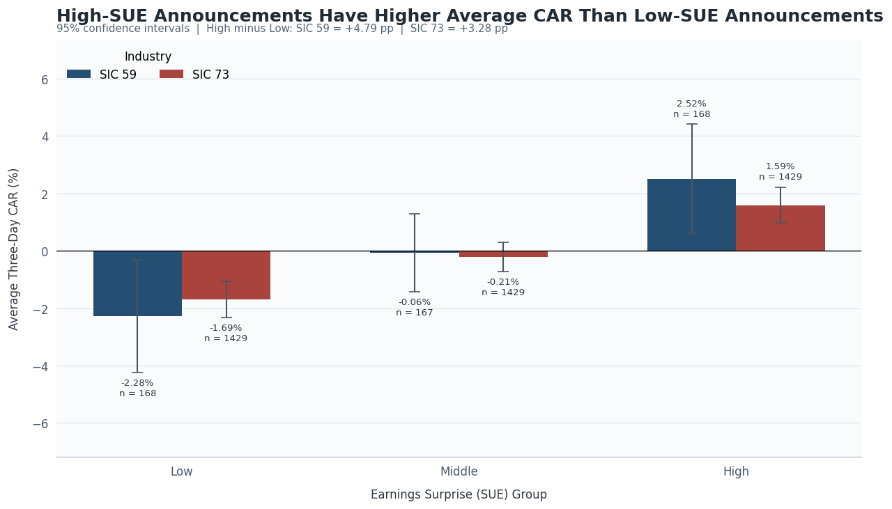
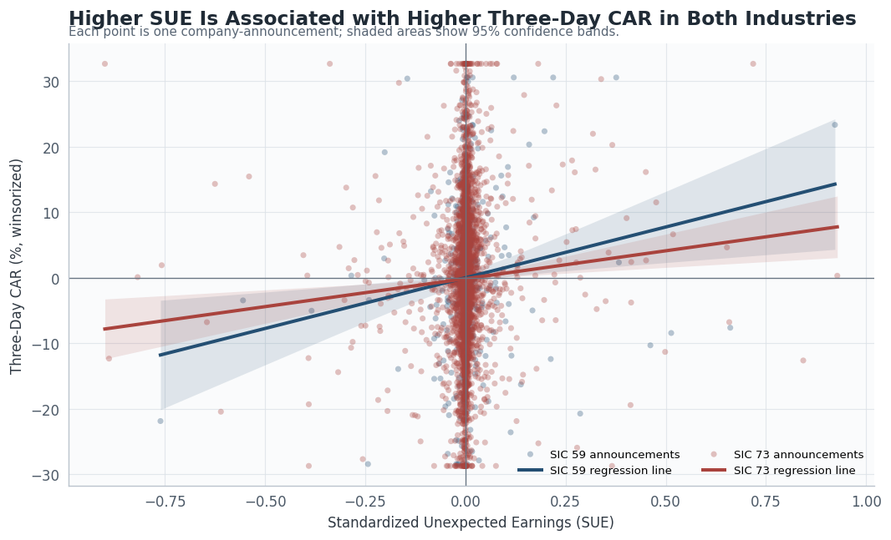
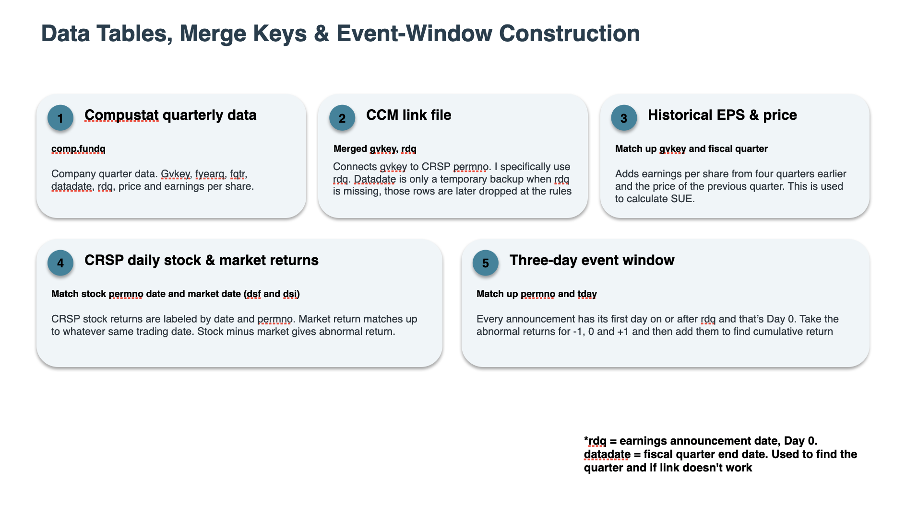

# Why Do Stronger Earnings Surprises Lead to Better Stock Returns for Miscellaneous Retail?

**Author:** Connor Lee · BAN 4550, Fall 2026 · 59 CVS Health Miscellaneous Retail · Comparison industry:  SIC 73 Business Services

## The question
One or two sentences in plain words: who the client is and what they want to know.

Mr. Potter wants to know if stronger than expected earnings performance is linked with a better stock market reaction. This analysis compares the surprise earnings with three day cumulative abnormal returns for companies in SIC 59 with results of those in SIC 73

## Main result

Throughout all 503 announcements from 45 SIC: 59 companies, the High surpass earnings group had an average car of 4.70 percentage points higher than the low purpose earnings group. The difference is statistically significant, t = 3.43 and p < 0.001. In the SIC 73, the high surprise earnings group had an average cumulative return 3.28 percentage points higher compared to the low surprise earnings group, t = 7.25 p < .001, based on 387 companies and 4287 announcements. This is a positive relationship between earnings purpose and the stock reaction in not only miscellaneous retail, but also business services. They do not prove that higher earnings cause higher returns all the time. 



## Is the difference real?

Statistically significant in both: 
SIC 59: 4.79 percentage points, t = 3.43, and p < 0.001
SIC 73: 3.28 percentage points, t = 7.25, and p < 0.001.
Positive, statistically significant relationship between SUE and CAR. SIC 59 coefficient is 0.1844 and has a r squared of .02, SIC 73 has a coefficient of 0.1163 and a r squared of .004. A one point increase in SUE is associated with a 0.1844 increase in CAR and a one point increase in SUE is associated with a 0.1163 increase in CAR. The low r squared show that surprise earnings alone only has small explanatory power in stock reactions. Winsorized coefficients stayed positive but became smaller: SIC 59 changed from 0.1844 to 0.1549 (p = 0.005), and SIC 73 changed from 0.1163 to 0.0853 (p < 0.001). The overall finding did not change.



## Why the industries differ
The reason you proposed, and what Figure 3 showed when you checked it.


## Advice for the client
- **Business implication:** what the client should do or learn.
- **Limitation:** one reason to be careful (data, sample size or method).
- **Next questions:** one predictive and one prescriptive question.

## Data
- Sources: Compustat (`comp.fundq`), CRSP (`crsp.dsf`, `crsp.dsi`), accessed through WRDS. Add or remove tables to match your work.
- **The data are not included in this repository** because of the WRDS license. Someone with WRDS access can rebuild the results by running the notebook with the link file in the same folder.

- Sample period and rules: [period, filters].

## How the tables fit together
Your merge map (image) and two or three sentences on the keys and the date rule.



## How I checked the results
Your most useful check in two or three sentences: what you expected, what you found, what you did.

## Changes since Project 2
| What was wrong | How I fixed it | How the results changed |
| --- | --- | --- |
| | | |

Write "None" if there was nothing to fix.

## Where the code came from
The class notebook, an AI tool, or your own changes. List every AI conversation you used, one line per conversation:

| AI tool | Link (or PDF in docs/) | What I used it for |
| ChatGPT |  | Code for figures and tables |
| | | |

Write "None" if you used no AI.

## Files
```
notebooks/   Last_First_Project3.ipynb (runs top to bottom on WRDS JupyterHub)
figures/     figure1.png, figure2.png, figure3.png, merge_map.png
docs/        Last_First_Project3.pdf (slides)
README.md
```
