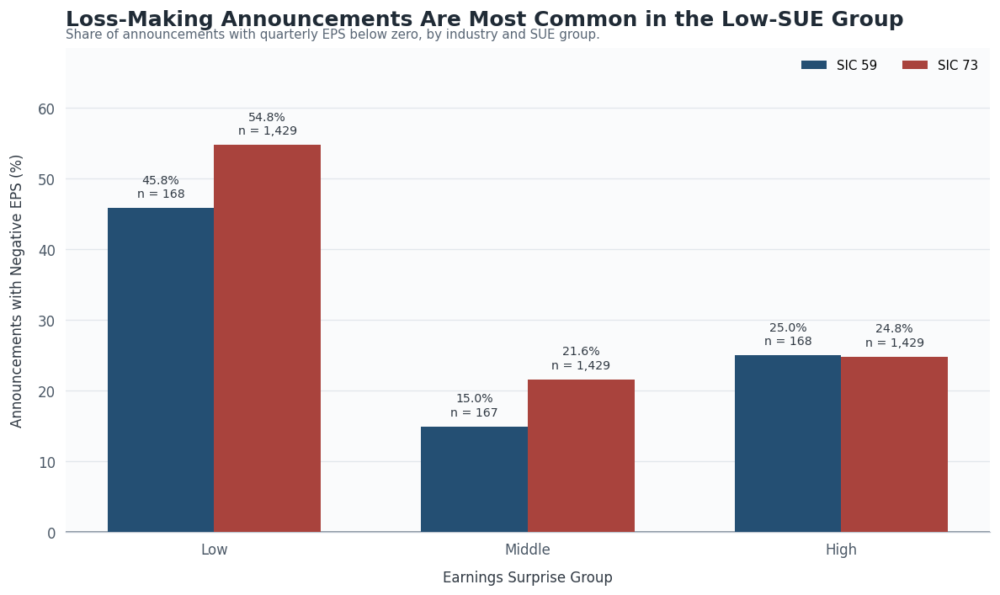

# Why Do Stronger Earnings Surprises Lead to Better Stock Returns for Miscellaneous Retail?

**Author:** Connor Lee · BAN 4550, Fall 2026 · 59 CVS Health Miscellaneous Retail · Comparison industry:  SIC 73 Business Services

## The question
One or two sentences in plain words: who the client is and what they want to know.

Mr. Potter wants to know if stronger than expected earnings performance is linked with a better stock market reaction. This analysis compares the surprise earnings with three day cumulative abnormal returns for companies in SIC 59 with results of those in SIC 73

## Main result

Throughout all 503 announcements from 45 SIC: 59 companies, the High surpass earnings group had an average car of 4.70 percentage points higher than the low purpose earnings group. The difference is statistically significant, t = 3.43 and p < 0.001. In the SIC 73, the high surprise earnings group had an average cumulative return 3.28 percentage points higher compared to the low surprise earnings group, t = 7.25 p < .001, based on 387 companies and 4287 announcements. This is a positive relationship between earnings purpose and the stock reaction in not only miscellaneous retail, but also business services. They do not prove that higher earnings cause higher returns all the time. 


## Is the difference real?

Statistically significant in both: 
SIC 59: 4.79 percentage points, t = 3.43, and p < 0.001
SIC 73: 3.28 percentage points, t = 7.25, and p < 0.001.
Positive, statistically significant relationship between SUE and CAR. SIC 59 coefficient is 0.1844 and has a r squared of .02, SIC 73 has a coefficient of 0.1163 and a r squared of .004. A one point increase in SUE is associated with a 0.1844 increase in CAR and a one point increase in SUE is associated with a 0.1163 increase in CAR. The low r squared show that surprise earnings alone only has small explanatory power in stock reactions. Winsorized coefficients stayed positive but became smaller: SIC 59 changed from 0.1844 to 0.1549 (p = 0.005), and SIC 73 changed from 0.1163 to 0.0853 (p < 0.001). The overall finding did not change.


## Why the industries differ
Retail and business services are two industries that have different levels of demand and risk. SIC 59 companies sell miscellaneous products to
people, while SIC 73 companies just provide services to businesses and may be more likely to face changes in budgets and spending, and demand. Retail is stuff like everyday shopping, so changes in spending can affect its stock prices more. SIC 73 provides business services, so its stock prices is more rigid and dependent on other companies. Figure 3 checks one measurable difference: the share of announcements with negative quarterly earnings per share in each surprise earnings. In the low surprise earnings group, 45.83% of SIC 59 announcements and 54.79% of SIC 73 announcements had negative earnings per share. Middle has 14.97% and 21.62%. Lastly the High group had 25.00% and 24.84%. 



## Advice for the client
**Business implication:** Stronger earnings surprises are associated with better stock returns in both industries. In SIC 59, a one-unit increase in SUE was associated with a 0.1844 increase in CAR, suggesting stronger earnings performance is linked to better stock reactions.
**Limitation:** CVS operates across retail pharmacy, healthcare services, and health insurance. Its stock price can be influenced by factors such as, healthcare costs, insurance, pharmacy sales, and any changes in business
The basic regression has a low r squared: SIC 59: 2.0% of variation explained, SIC 73: 0.4% of variation explained
Prescriptive: Which of CVS's areas should management focus on: pharmacy, healthcare delivery, or health insurance to increase profit and returns?
Predictive: Will CVS's decreasing or increasing profitability in its health insurance business cause a positive or negative stock reaction over the next year?


## Data
- Sources: Compustat (`comp.fundq`), CRSP (`crsp.dsf`, `crsp.dsi`), accessed through WRDS. Add or remove tables to match your work.
- **The data are not included in this repository** because of the WRDS license. Someone with WRDS access can rebuild the results by running the notebook with the link file in the same folder.

- Sample period and rules: SIC 59: 1,110 quarters to start, 1,029 after matching, and 503 at the end leaving a total of 45 companies. SIC 73: 9,852 to start, 9,061 after matching, and 4,287, giving 387 companies. Data from 2021 to 2024 and got rid of data that did not pass the rules.

## How the tables fit together

Started with quarterly earnings data from Compustat, including each company's earnings announcement date (rdq).We used rdq to match each company, gvkey to the correct stock, permno in the CCM link file. rdq here instead of datadate, but datedate is plan b. Added each stock's daily returns from CRSP and lined them up with the market's returns by date. Lastly calculated abnormal returns and matched them to the three day window around each earnings announcement (-1, Day 0, +1)


## How I checked the results


## Changes since Project 2
| What was wrong | How I fixed it | How the results changed |
| Usage of markdowns and rdq instead of datedate | Included markdowns labelling sections and what it does. Also explained why I use rdq (data date would cause missing data, so only rely on it as a fallback) | Same results |

## Where the code came from

| ChatGPT | https://chatgpt.com/share/6b04daab-0c18-83ea-b9a8-c8d417430c1f | Code for figures and tables |


## Files
```
notebooks/   Last_First_Project3.ipynb (runs top to bottom on WRDS JupyterHub)
figures/     figure1.png, figure2.png, figure3.png, merge_map.png
docs/        Last_First_Project3.pdf (slides)
README.md
```
